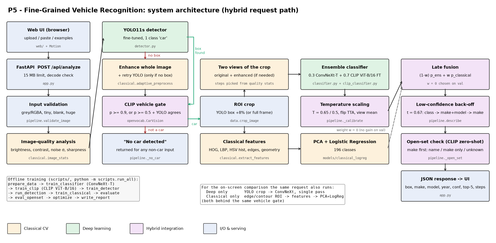

# P5 - Intelligent Fine-Grained Vehicle Recognition (Stanford Cars)

Detects the vehicle in a photo, draws its bounding box and predicts its **make, model and year**
(196 Stanford Cars classes) with a confidence score. Anything that is not a car returns **"No car
detected"**, and cars outside the 196 training classes are named open-vocabulary and flagged as
**unseen models**. The system combines classical computer vision (adaptive enhancement, edges/contours,
HOG/LBP/colour/geometry features) with deep learning: a YOLO11 detector, a ConvNeXt + robust CLIP
ViT-B/16 ensemble, and a CLIP vehicle gate with zero-shot naming over 954 catalogued models.

## Results (official test split, 8,041 unseen images)

| Approach | Top-1 | Top-5 |
|---|---|---|
| Classical features (HOG + LBP + colour + edges + geometry -> PCA + LogReg) | 14.53% | 32.94% |
| Deep learning (YOLO11s crop -> ConvNeXt-T) | 94.52% | 99.19% |
| **Hybrid** (ConvNeXt + robust CLIP ensemble, enhancement views, flip TTA, calibration) | **95.90%** | **99.75%** |

Robustness, end-to-end on 1,000 images per condition (deep vs hybrid): 8x low resolution 75.8% -> 82.7%,
very dark + noisy 89.7% -> 93.0%, 15 deg rotation 92.4% -> 94.8%, 30% occlusion 88.7% -> 87.5%.

Bad input and unseen cars:
- The vehicle gate accepts 99.9% of real cars and rejected all 16 non-car probe photos.
- 80% of simulated unseen models are flagged as unseen; only 0.8% of known cars are wrongly flagged.
- Unfamiliar cars are answered make first: a model is named only when CLIP is sure, otherwise
  "<make>, model not recognised" or "Unknown car". This cuts wrong answers on simulated unseen cars from
  26% to 17% (car in the catalogue) and from 66% to 35% (car not in the catalogue).

| Detection | mean IoU | mAP@0.5 | mAP@0.5:0.95 |
|---|---|---|---|
| YOLO11s fine-tuned (ours) | 0.954 | 0.989 | 0.931 |
| YOLO11n COCO-pretrained | 0.944 | 0.854 | 0.784 |
| Classical edge/contour ROI | 0.654 | 0.641 | 0.225 |

FP16 ConvNeXt: 53 MB, 5.5 ms GPU. INT8 (ONNX): 27 MB, -0.14 points. CLIP fine-tune: 165 MB FP16, 8.9 ms GPU.
App latency: about 0.15 s per request on GPU.

Model files above 100 MB (`models/clip_ft_fp16.pt`) need Git LFS on GitHub (`.gitattributes` is
included).
Full tables: [`eval_P5_T80.md`](eval_P5_T80.md).

- **Team:** Kevin Isaac (1RUA24CSE0200), Kokila C G (1RUA24CSE0206), Dhruthishree V (1RUA24CSE0130)
- **Repository:** https://github.com/kevinlochan31/fine-grained-vehicle-recognition
- **Live demo:** https://kevinisaacbtech24--autolens.us-east.modal.run
- **Evaluation file:** [`eval_P5_T80.md`](eval_P5_T80.md)
- **Design document:** [`docs/design_document.md`](docs/design_document.md)
- **Architecture diagram:** [`docs/architecture.png`](docs/architecture.png)



## Repository layout

```
app.py                     FastAPI server: /api/analyze, /api/performance + serves the web UI
web/                       custom frontend (index.html, styles.css, app.js; animations with Motion,
                           the vanilla-JS successor of Framer Motion, vendored in web/vendor/)
app_gradio.py              earlier Gradio UI (kept as a fallback)
start_app.bat              double-click launcher on Windows
src/
  config.py                paths & hyper-parameters
  data.py                  annotation parsing, train/val/test split, crop cache, torch dataset + augmentations
  classical.py             quality analysis, adaptive gamma/CLAHE/bilateral, Canny, contours, classical ROI,
                           HOG / LBP / HSV / edge-orientation / geometric features
  detector.py              YOLO11 wrapper with classical-ROI fallback, IoU
  classifier.py            ConvNeXt wrapper (PyTorch FP16 or ONNX INT8 backend), flip TTA
  clip_classifier.py       robust fine-tuned CLIP ViT-B/16 classifier (ensemble member)
  openvocab.py             CLIP vehicle gate ("No car detected") + zero-shot naming over 954 models
  pipeline.py              end-to-end hybrid pipeline, fusion, hierarchical low-confidence handling
  metrics.py               top-k, AP / mAP (COCO 101-pt), class-aware mAP, ECE
scripts/
  prepare_data.py          parse .mat annotations, split, cache crops, build YOLO dataset
  train_classifier.py      transfer learning of ConvNeXt-T (ImageNet-22k) on 196 classes
  train_clip.py            fine-tune CLIP ViT-B/16 with harsh lighting/blur/JPEG/viewpoint/occlusion augmentation
  eval_openset.py          vehicle-gate + unseen-model evaluation, tunes the open-set thresholds
  eval_unknown.py          make-first "responsible answer" rule for unfamiliar cars, tunes its thresholds
  train_detector.py        fine-tune YOLO11s on Stanford Cars boxes
  run_detection.py         IoU / mAP of fine-tuned YOLO vs COCO YOLO vs classical ROI on the test split
  train_classical.py       classical-feature classifier + feature-group ablation
  evaluate.py              comparison, ablation, robustness, thresholds, failure cases, tunes hybrid config
  optimize.py              FP16, ONNX INT8 static quantisation, global pruning - size / latency / accuracy
  write_report.py          generates eval_P5_<TeamID>.md
  run_all.py               runs every step in order
models/                    deployable weights (classifier_fp16.pt, yolo_cars.pt, classical_logreg.joblib,
                           classifier_int8.onnx, hybrid_config.json)
results/                   JSON metrics, figures, failure galleries
docs/                      design document, architecture diagram (+ script that draws it)
```

## Quick start (inference / app only)

```bash
pip install -r requirements.txt
```

```bash
python app.py
```

Then open http://127.0.0.1:7860. Or with Docker:

```bash
docker build -t p5-cars . && docker run -p 7860:7860 p5-cars
```

Set `CVH_BACKEND=onnx` to use the INT8-quantised ONNX classifier on CPU.

## Reproducing the results

1. Get the Stanford Cars dataset (Kaggle mirror `cars_train/`, `cars_test/`, `car_devkit/`) and the
   test labels file `cars_test_annos_withlabels.mat` (the Kaggle devkit has no test labels; the file is
   mirrored e.g. in the Hugging Face dataset `iharabukhouski/stanford_cars`). Extract into
   `~/cvh/data/raw/` (or set `CVH_WORK_DIR`) so that you have:
   ```
   ~/cvh/data/raw/cars_train/cars_train/*.jpg
   ~/cvh/data/raw/cars_test/cars_test/*.jpg
   ~/cvh/data/raw/car_devkit/devkit/{cars_meta,cars_train_annos,cars_test_annos_withlabels}.mat
   ```
2. Install a CUDA build of PyTorch, then the requirements:
   ```bash
   pip install torch torchvision --index-url https://download.pytorch.org/whl/cu128
   ```
   ```bash
   pip install -r requirements.txt
   ```
3. Run everything (about 2.5 h on an RTX 5060 Laptop GPU):
   ```bash
   python -m scripts.run_all
   ```
   ```bash
   python -m scripts.write_report --team T80 --usns "1RUA24CSE0200,1RUA24CSE0206,1RUA24CSE0130"
   ```

Seeds are fixed (`SEED=42`); the validation split is a stratified 10% of the official training set, and
the official 8,041-image test split is used only for final evaluation.

## Deploying the public URL (Modal)

The live demo runs on [Modal](https://modal.com) as a CPU container (2 cores, 6 GB RAM), defined in
`modal_app.py` (image with CPU PyTorch + requirements, CLIP weights pre-fetched at build time).

1. Install the client and sign in once (browser-based; the token is stored locally, never in the repo):
   ```bash
   pip install modal
   ```
   ```bash
   modal token new
   ```
2. Deploy (prints the public https URL; first build about 4 minutes):
   ```bash
   modal deploy modal_app.py
   ```

A warm container answers a scan in about 1-4 s. After 20 minutes without traffic it scales to zero and the
next request takes up to about 2.5 minutes to start, so keep one container warm during judging:
```bash
KEEP_WARM=1 modal deploy modal_app.py
```
(Windows PowerShell: `$env:KEEP_WARM="1"; modal deploy modal_app.py`.) The same app also runs anywhere
Docker runs (`Dockerfile`), e.g. a Hugging Face Space with `python -m scripts.deploy_hf`.

## Limitations and ethics (summary - details in the design document)

- Make, model and year are learned only for the 196 Stanford Cars classes (mostly US-market cars,
  1991-2012). Other cars are flagged as unseen (about 80% of the time) and answered with a catalogue name
  only when CLIP is sure, otherwise with the make or "Unknown car", never with a year. Unflagged unseen
  cars get the nearest known class.
- Year prediction is the weakest part: many generations look identical across years.
- One primary vehicle per image is classified; crowded scenes are out of scope.
- No number-plate recognition, person identification or tracking is done, and the system must not be
  used for surveillance of individuals. Dataset images are from the web and keep their original licences.
