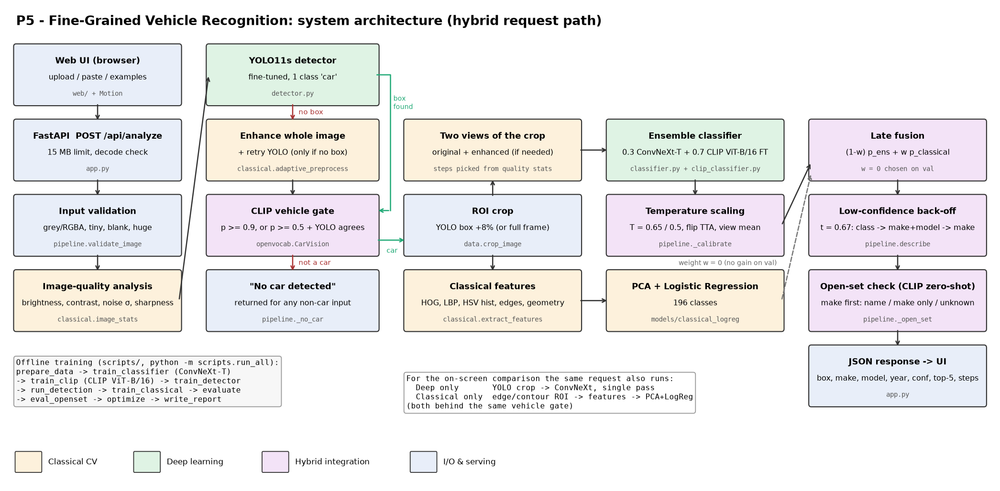

# Design Document - P5: Intelligent Fine-Grained Vehicle Recognition and Analysis System

| | |
|---|---|
| Problem ID | P5 |
| Team ID | T80 |
| Members / USNs | Kevin Isaac (1RUA24CSE0200), Kokila C G (1RUA24CSE0206), Dhruthishree V (1RUA24CSE0130) |
| Repository | https://github.com/kevinlochan31/fine-grained-vehicle-recognition |
| Live application | https://kevinisaacbtech24--autolens.us-east.modal.run |

## 1. Problem statement and goals

Build an application that, given a real-world photo, **localises the vehicle with a bounding box** and
identifies its **manufacturer, model and manufacturing year** among the 196 fine-grained classes of the
Stanford Cars dataset, showing a confidence score and the intermediate image-processing results, using
a **hybrid of classical computer vision and deep learning**.

**Goals**

1. High top-1 / top-5 fine-grained accuracy on the unseen official test split.
2. Accurate localisation (IoU, mAP) of the vehicle.
3. Robustness to illumination, viewpoint, occlusion and resolution changes.
4. A measurable comparison of classical-only, deep-only and hybrid approaches, with an ablation.
5. A model optimisation step (reduced precision, quantisation, pruning) with size/latency numbers.
6. Honest handling of low-confidence predictions and documented failure cases.
7. A public web app that answers in well under 10 s on a phone or laptop.

**Non-goals** (as allowed by the brief): number-plate recognition, vehicle tracking, traffic events,
multi-vehicle classification in crowded scenes.

## 2. Dataset

Stanford Cars: 16,185 images, 196 classes (make + model + year), one bounding box per image.

| Split | Images | Use |
|---|---|---|
| train | 7,356 | training (official train minus validation) |
| val | 788 | stratified 10% of official train (at least 1 image per class), used for model selection, fusion weight and threshold tuning |
| test | 8,041 | official test split, used **only** for the final numbers |

Labels are parsed from `cars_train_annos.mat` / `cars_test_annos_withlabels.mat`; class names are split
into make / model / year (handling multi-word makes such as "Aston Martin", "Land Rover", "AM General").
This gives 49 makes and 189 make+model groups. These are used for the hierarchical low-confidence back-off.

Observations that shaped the design: images vary from 78 px to over 5,000 px wide; most show a single
dominant car on a clean or street background; several classes are the same body style in different years
(e.g. "Chevrolet Silverado 2500HD Regular Cab 2012" vs "Chevrolet Silverado 1500 Regular Cab 2012",
"Audi TT RS Coupe 2012" vs "Audi TTS Coupe 2012"); only the main car is annotated even when other cars are
visible, which matters for mAP.

## 3. System architecture

The diagram is generated from `docs/make_architecture.py`. Each box maps to code:

| Stage | Code |
|---|---|
| Input validation (type, size, blank, RGBA/grey, very large images) | `src/pipeline.py::validate_image` |
| Image-quality analysis (brightness, contrast, Immerkaer noise sigma, Laplacian sharpness, resolution) | `src/classical.py::image_stats` |
| YOLO11s detector fine-tuned on Stanford Cars boxes | `src/detector.py`, `scripts/train_detector.py` |
| CLIP ViT-B/16 vehicle gate ("No car detected") | `src/openvocab.py::CarVision`, `src/pipeline.py::run` |
| Classical ROI (detector-free baseline for the classical-only pipeline) | `src/classical.py::classical_roi` |
| ROI crop with 8% context | `src/data.py::crop_image` |
| Adaptive enhancement (gamma, CLAHE on L channel, bilateral denoise, bicubic upscaling) | `src/classical.py::adaptive_preprocess` |
| ConvNeXt-Tiny classifier + horizontal-flip TTA | `src/classifier.py`, `scripts/train_classifier.py` |
| Robust CLIP ViT-B/16 fine-tune (ensemble member) | `src/clip_classifier.py`, `scripts/train_clip.py` |
| Classical features + PCA + logistic regression | `src/classical.py::extract_features`, `scripts/train_classical.py` |
| Calibrated ensemble, late fusion, hierarchical low-confidence handling | `src/pipeline.py::VehicleRecognizer.run / describe` |
| Open-set check and open-vocabulary naming (954-model catalogue) | `src/pipeline.py::_open_set`, `data_meta/car_catalogue.json` |
| Web UI / API | `web/`, `app.py` |

## 4. Classical computer vision components

| Requirement | Implementation |
|---|---|
| Image preprocessing and normalisation | ImageNet mean/std normalisation for the CNN; histogram equalisation before hand-crafted features; adaptive gamma / CLAHE / bilateral filter / upscaling chosen from measured image statistics; gray-world white balance helper |
| Edge detection and contour analysis | Median-based automatic Canny thresholds; morphological closing; external contours; contour area, extent, solidity, circularity and log-Hu moments |
| Colour and texture features | HSV 8x4x4 joint histogram + colour moments; uniform LBP (P=8, R=1) histograms on a 2x3 grid; Sobel edge-orientation histogram |
| Shape features | HOG (9 orientations, 8x8 cells, 2x2 blocks) on a 192x128 canonical crop |
| Region-of-interest extraction | Edge/contour-based ROI (detector-free baseline and fallback), plus ROI crop with context padding |
| Geometric feature analysis | Box aspect ratio, edge density, contour extent/solidity/circularity, Hu moments |

**Why these choices.** HOG captures the silhouette (body style), LBP captures grille/headlight texture,
colour helps little for model identity (cars of one model come in many colours) but the ablation measures
this, and geometry encodes body proportions. Enhancement is **adaptive**: it only fires when the measured
statistics call for it (e.g. gamma only if mean brightness < 70; CLAHE clip limit grows as contrast drops;
bilateral filtering only if the estimated noise sigma > 12). On normal test images it is usually a no-op,
so it does not hurt clean inputs.

## 5. Deep learning components

**Detector.** YOLO11s (COCO-pretrained) fine-tuned for 15 epochs on the training boxes as a single class
"car" (640 px, cosine LR, mosaic off for the last 3 epochs). Fine-tuning teaches the detector the dataset's
box convention (the *main* car, tight boxes) and suppresses background cars. We compare it with the
COCO-pretrained YOLO11n (classes car/bus/truck) and the classical ROI.

**Classifier.** ConvNeXt-Tiny pretrained on ImageNet-22k (fine-tuned at 384 px on ImageNet-1k), fine-tuned
on the 196 classes (transfer learning):

- input: GT-box crop + 8% context, resized to 384x384;
- augmentation: random resized crop (scale 0.6-1), horizontal flip, colour jitter, random greyscale,
  blur, rotation up to 12 degrees, random erasing (occlusion), random down-scaling to 20-50%
  (resolution robustness);
- AdamW (lr 2e-4 backbone, 10x for the new head), weight decay 0.05, 1-epoch warm-up + cosine schedule,
  label smoothing 0.1, drop-path 0.2, bf16 mixed precision, 30 epochs, batch 32;
- model selection on the validation split.

Why ConvNeXt-T: a strong ImageNet-22k representation gives high fine-grained accuracy at a size (28 M
params) that still runs on a CPU-only free host within the latency budget.

**Robust second classifier: CLIP ViT-B/16 (LAION-2B), fine-tuned.** User testing showed the first version
failing on real-world photos unlike Stanford Cars. CLIP's web-scale pre-training generalises much better to
such photos, so a second classifier was trained (`scripts/train_clip.py`):

- the 196-way head is **initialised from CLIP text embeddings** of the class names (zero-shot already gives
  87.2% val top-1 before any training), which preserves CLIP's robustness during fine-tuning;
- **layer-wise learning-rate decay** (0.75 per block) so early ViT layers change little;
- much **harsher augmentation**: random gamma darkening/over-exposure, down-scaling to 12-45%, sensor noise,
  JPEG compression (quality 15-90), perspective warp (viewpoint), rotation, strong colour jitter, blur,
  greyscale and random erasing (occlusion);
- 15 epochs, AdamW, label smoothing 0.1, bf16. Best val top-1 96.7% (ConvNeXt: 95.7%).

The two classifiers are calibrated separately (temperatures 0.65 and 0.5) and averaged with weights
0.3 / 0.7 chosen on validation.

## 6. Hybrid integration

1. **Detection-driven ROI.** The classifier sees the detected vehicle region, not the whole image. If YOLO
   finds no box, the whole frame is enhanced (classical) and YOLO is retried.
2. **Vehicle gate: "No car detected".** A CLIP ViT-B/16 image embedding of the frame and the YOLO crop is
   scored against 21 car prompts and about 45 everyday non-car prompts (people, animals, plants, food,
   rooms, documents, other vehicles such as bikes or buses, clocks). The input is accepted if
   P(car) >= 0.9, or P(car) >= 0.5 **and** the YOLO detector agrees (box confidence >= 0.3). Otherwise
   every pipeline returns "No car detected". This fixed the original failure where a photo of tulips was
   labelled a Lamborghini: the fine-tuned single-class detector had learned that every image contains a
   car (it fired at 0.53 on the tulips), but CLIP gives the tulips P(car) = 0.00003.
3. **Classical enhancement as a second view.** When the quality analysis asks for it, the adaptively
   enhanced crop is classified in addition to the original and the predictions are averaged.
4. **Test-time augmentation.** Average of original and horizontally flipped logits, for both networks.
5. **Calibrated ensemble + late fusion.** `p = 0.3 p_ConvNeXt + 0.7 p_CLIP-FT` (each temperature-scaled),
   then `(1 - w) p + w p_classical` with `w` chosen on validation (0: no gain).
6. **Open-set check: cars outside the 196 classes.** The second user failure, a 2024 Aston Martin
   labelled as a Lamborghini or Hyundai, cannot be fixed by more training on Stanford Cars, because no
   classifier can output a class it was never given. Instead, zero-shot CLIP scores the crop against a
   954-entry catalogue: the 196 Stanford classes plus 758 further models from 83 makes, from the 1990s to
   2025 and from global markets. The car is declared **unseen** when all of these hold:
   - CLIP's best match is a catalogue model outside the training set, from a different model family than
     the classifier's answer;
   - CLIP is reasonably sure (top probability >= 0.2) and puts >= 30% of its probability outside the
     training set;
   - the ensemble is not confident (< 0.7).

   Thresholds were tuned on validation by simulating unseen models: each image's true class is hidden from
   the classifiers. This routing decision uses CLIP on the crop.

   **Responsible answer for unfamiliar cars** (`openvocab.decide_unfamiliar`, `scripts/eval_unknown.py`).
   An early version always answered with CLIP's top catalogue model. That produced confident-looking wrong
   names, e.g. a Bugatti special edition named "Ferrari F8 Tributo" (46%) although the classifier's make
   was right (closest class Bugatti Veyron). The answer is now built **make first**:
   - The make probability is fused from the classifier (summed over its classes) and CLIP (summed over
     the catalogue), with weight 0.5 each.
   - For naming, CLIP uses the mean embedding of the whole frame and the crop. On validation this names the
     make better than the crop alone (92.6% vs 86.5%).
   - A specific model is named only if CLIP's best model belongs to that make and CLIP is at least 80% sure.
   - Otherwise the app reports "<make>, model not recognised" (fused make >= 40%) or "Unknown car" (make
     unclear).
   - The best unconfirmed guess and the closest trained class stay visible as candidates.

   The same answer replaces the old "Uncertain - see top-5" for known-looking cars when the classifier is
   below the threshold at every level of its hierarchy, so its top class is never presented as the answer.
   The three thresholds were chosen on validation to maximise correct answers minus wrong answers on
   simulated unseen cars (both in and not in the catalogue); see section 8.
7. **Low-confidence handling.** Class probabilities are summed into make+model and make groups. If the
   top class is below the threshold `t` (chosen on validation as the lowest value giving at least 98.5%
   precision on accepted predictions), the app backs off to "make+model, year uncertain", then
   "make only", then "uncertain, see top-5". The colour of the box encodes the status.

## 7. Training and evaluation methodology

- Seeds fixed; stratified validation split; the test split is never used for training or tuning.
- Classification: top-1 / top-5, also make-level and make+model-level accuracy, and expected calibration
  error (ECE).
- Localisation: IoU of the primary predicted box with the GT box; detection: AP@0.5 and AP@0.5:0.95
  (COCO 101-point interpolation, up to 10 detections per image). A class-aware mAP@0.5 is also reported:
  a detection counts only if IoU >= 0.5 **and** the fine-grained class is right.
- Efficiency: parameters, file size, batch-1 latency on GPU and CPU for each optimised variant.
- Robustness: end-to-end (detector + classifier) on 1,000 random test images under synthetic darkness,
  very dark + noise, over-exposure, 4x/8x down-sampling, 30% occlusion, Gaussian noise, motion blur,
  15 degree rotation and a perspective (viewpoint) warp. Also accuracy by quintile of natural brightness
  and vehicle size.
- Confidence: coverage vs accuracy-on-accepted curve and the hierarchical back-off outcome.

## 8. Results

All tables, in the order required by the brief, are in [`eval_P5_T80.md`](../eval_P5_T80.md); raw numbers
are in `results/*.json` and figures in `results/figures/`. Headline numbers on the 8,041 unseen test images:

| Approach | Top-1 | Top-5 | Make acc. | class-aware mAP@0.5 |
|---|---|---|---|---|
| Classical features (detected crop -> HOG+LBP+colour+edge+geometry -> PCA+LogReg) | 14.53% | 32.94% | 24.01% | 0.072 |
| Deep learning (YOLO crop -> ConvNeXt-T) | 94.52% | 99.19% | 98.41% | 0.927 |
| **Hybrid** (ConvNeXt + robust CLIP ensemble, enhancement views, TTA, calibration) | **95.90%** | **99.75%** | see eval file | **0.944** |

With open-set routing switched on (a known car wrongly sent to "unseen" counts as an error) the strict
hybrid top-1 is 95.45%.

| Detector | mean IoU | mAP@0.5 | mAP@0.5:0.95 |
|---|---|---|---|
| **YOLO11s fine-tuned (ours)** | **0.954** | **0.989** | **0.931** |
| YOLO11n COCO-pretrained | 0.944 | 0.854 | 0.784 |
| Classical edge/contour ROI | 0.654 | 0.641 | 0.225 |

**Interpretation.**

- *Classical vs deep.* Hand-crafted features reach 14.5% top-1, about 28x chance (0.51%), but cannot
  separate 196 visually similar classes; HOG is the most useful group (removing it costs 4.3 points,
  it alone gives 11.4%), colour is weak on its own (4.8%) because each model comes in many colours.
- *Detection matters.* Classifying the whole image instead of the detected crop costs 4.3 points with
  the same model and 1.8 points even with a model trained on whole images. Our detector crop is within
  0.02 points of oracle ground-truth boxes, so localisation is no longer a bottleneck.
- *Fine-tuning the detector* raises mAP@0.5 from 0.854 to 0.989: the COCO model also fires on background
  cars, which count as false positives because only the main car is annotated.
- *The robust CLIP member is the largest single gain* (ablation: removing it costs 1.3 points, 95.90% ->
  94.62%), and it matters most on hard inputs. End-to-end on 1,000 images per condition (strict scoring:
  "no car" and "unseen" answers count as errors), deep-only vs hybrid:
  - 8x down-sampling: 75.8% -> 82.7%
  - very dark + noisy: 89.7% -> 93.0%
  - 4x down-sampling: 90.7% -> 93.5%
  - 15 degree rotation: 92.4% -> 94.8%
  - perspective (viewpoint) warp: 94.2% -> 95.2%
  - motion blur: 89.4% -> 90.5%
  - Gaussian noise: 93.2% -> 94.5%

  The one exception is **30% occlusion: 88.7% -> 87.5%**, within noise for n = 1,000 (SE about 1 point).
  A diagnosis on 400 occluded images showed the ensemble's own answer is better than deep-only
  (89.8% vs 87.5%). The loss comes from the open-set check: a large foreign block makes CLIP see an
  "unfamiliar car" and re-route some correct answers. Requiring CLIP to be at least 20% sure of a
  specific outside model halved those re-routes.
- *Unseen models and bad input.* The vehicle gate accepts 99.9% of the 8,041 test cars and rejected
  every one of 16 non-car probe photos (people, food, animals, textures, a clock, the user's tulips).
  Zero-shot CLIP over the 954-model catalogue names the right make for 88% of test cars without any
  training. With each test car's class hidden from the classifiers (simulated unseen model), 80% are
  flagged as "not in the training set", while only 0.8% of known cars are wrongly flagged.
- *Responsible answers for unfamiliar cars* (`results/unknown.json`). Simulated unseen test cars
  (n = 5,266), new make-first rule vs the old "always name CLIP's top model":

  | Scenario | Correct model | Correct make only | No claim ("unknown car") | Wrong answer |
  |---|---|---|---|---|
  | Unseen car **in** the catalogue, old | 69.0% | - | 5.2% | 25.9% |
  | Unseen car **in** the catalogue, new | 55.6% | 18.8% | 8.1% | **17.4%** |
  | Unseen car **not in** the catalogue, old | 5.5% | - | 28.1% | 66.4% |
  | Unseen car **not in** the catalogue, new | 2.1% | 38.3% | 25.0% | **34.6%** |

  - Wrong answers fall by a third for catalogued cars and by half for uncatalogued ones.
  - The remaining wrong answers are mostly cases where the classifier was confident in a wrong trained
    class and the open-set check did not fire (15-17% of simulated unseen cars).
  - Known test cars: 98.5% still show their trained-class answer (unchanged), 1.1% show "make, model not
    recognised" (make right 78% of the time), 0.3% show "unknown car" and 0.1% get an open-vocabulary name.
  - Top-1 accuracy and every other metric are unchanged: they are computed from the class probabilities,
    and the routing decision is the same as before.
  - With the frame + crop input, zero-shot CLIP names the make of 93.3% of test cars (crop only 88.0%) and
    the model family of 85.0% (crop only 77.9%). Using the frame + crop also for *routing* was tried and
    rejected: it re-routed 1.0-1.2% of known cars and lowered robustness, e.g. occlusion 87.5% -> 85.7%.
- *Feature fusion* did not help: on validation, w = 0-0.075 gave identical accuracy and larger w was worse,
  so the tuned weight is 0. We report this honestly rather than forcing a weight; the classical branch
  contributes through enhancement, ROI fallback and the interpretable intermediate outputs instead.
- *Calibration.* Label smoothing made the CNN under-confident (ECE 0.118). Temperature scaling of each
  member (T = 0.65 and 0.5, fitted on validation) lowers the hybrid's test ECE to 0.011 without changing
  any prediction, which makes the confidence threshold meaningful: at t = 0.67 (98.5% precision on
  validation), 95.7% of test images are reported at full detail with 97.6% accuracy, 2.7% at make level
  with 98.6% make accuracy, and 1.1% are flagged uncertain.
- *Errors.* Of 330 hybrid errors, 11.8% are the right make+model with the wrong year, 66.4% the right make
  with the wrong model (TTS Coupe vs TT Hatchback, S5 vs A5, Express Van vs Express Cargo Van) and 21.8% a
  different make (mostly badge-engineered twins).

## 9. Failure-case analysis

Galleries are in `results/failures/` (green = ground-truth box, red = our box).

| # | Case (test image) | What happened | Cause | Mitigation |
|---|---|---|---|---|
| 1 | **Generation / year confusion** - Bentley Continental GT Coupe 2012 vs 2007 (14 errors), Dodge Caliber Wagon 2012 vs 2007 (22 errors in both directions) | Right make and model, wrong year, sometimes with high confidence | The generations share almost the same silhouette; differences are small (lamps, bumpers) and disappear in rear or side views | Hierarchical back-off reports "make + model (year uncertain)" when the year is not confident; part-based attention on lamps/grille would help |
| 2 | **"Confident but wrong" is mostly dataset label noise**: `test_02084` labelled GMC Yukon Hybrid, predicted GMC Terrain (conf 1.00); `test_07654` labelled Jeep Compass, predicted Grand Cherokee (1.00); `test_06881` / `test_06149` labelled Rolls-Royce Phantom, predicted Ghost (1.00) | Very high confidence, scored as an error | Inspecting the images shows the **prediction is right and the label is wrong** (the Terrain and Grand Cherokee are unmistakable; the Rolls-Royce photos show the Ghost's smaller grille) | Not a model fault; label noise caps the achievable accuracy. Reported rather than "fixed" |
| 3 | **Localisation on multi-car / collage images** - `test_00760` (Lamborghini show stand), `test_01431` (Ford GT collage), `test_04104`, `test_02277` (two Nissan NV vans) | Our box covers a different car than the annotated one (IoU 0.07-0.23), yet the class is often still right | Stanford Cars annotates only one car per image; when several cars of the same model appear, "which one" is arbitrary. For the show stand the annotated car is small and the detector picks the whole scene | Rank boxes by confidence x size (already done); multi-vehicle classification is future work |
| 4 | **Dark / low-contrast body variants** - `test_04142` BMW 3 Series Wagon in a dark scene with a "click here" watermark predicted Sedan (0.71); `test_07738` Bugatti Veyron Coupe vs Convertible from the front (0.60); `test_07940` dark studio V8 Vantage predicted Virage (0.89) | Right make, wrong body style | The distinguishing part (wagon roof, roof line) is in shadow or not visible from a frontal view | Hybrid recovers most dark images (+3.3 points); remaining cases mostly get medium confidence and the make-level back-off |
| 5 | **Very small / low-resolution vehicle** - `test_04858`, `test_01583` Audi V8 Sedan vs Audi 100 Sedan (1994) at 80-95 px; `test_07734` Audi 100 Wagon predicted Daewoo Nubira Wagon | Wrong class at low resolution | The 1994 Audi V8 and Audi 100 share the same body; at low resolution only the grille differs | Low-resolution augmentation in both networks (hybrid +6.9 points at 8x down-sampling); top-5 always contains the sibling |
| 6 | **User-reported: a photo of tulips labelled "Lamborghini Gallardo"** (first version) | A non-car was given a car class | The fine-tuned single-class detector fires on almost anything (0.53 on the tulips) because every training image contains a car, and a closed-set softmax must pick one of the 196 classes | **Fixed**: CLIP vehicle gate (P(car) = 0.00003 for the tulips), now "No car detected" |
| 7 | **User-reported: a 2024 Aston Martin labelled "Lamborghini" / "Hyundai Veloster"** (first version) | An unseen model was forced into a wrong class | The car is not one of the 196 classes (the newest Aston Martin in the dataset is from 2012); no closed-set classifier can name it | **Fixed**: the open-set check flags it. With the make-first rule it now reads "Aston Martin, model not recognised (outside the supported classes)" (make 87%), with "Aston Martin Vantage" (63%) as the best unconfirmed guess and the closest trained class (Aston Martin V8 Vantage Convertible 2012) |

| 8 | **User-reported: a Bugatti special edition named "Ferrari F8 Tributo" (46%)** | A wrong make, with a guess presented as the answer | The car is in neither the 196 classes nor the catalogue. The open-set branch replaced the classifier's correct make (closest class Bugatti Veyron, make 67%) with CLIP's top model, which CLIP itself was unsure of | **Fixed**: make-first rule. Now "Bugatti, model not recognised (outside the supported classes)", with Bugatti Divo as the best unconfirmed guess |
| 9 | **User-reported: an Indian-market Ford Figo shown as "Ford Fiesta Sedan 2012"** (21%, flagged "low confidence") | A low-confidence guess shown as the big title | Not in the dataset or the catalogue; the classifier split its probability between Fiesta, Focus and Hyundai hatchbacks, and CLIP's make was also unclear | **Fixed**: answered "Unknown car (outside the supported classes?)", with the Fiesta kept as the closest unconfirmed guess. Adding regional models to the catalogue would let it name the make |

Several further test labels also look inconsistent with their images (e.g. `test_03061` labelled
"Hyundai Accent Sedan 2012" shows a Genesis Coupe advert; `test_02832` labelled "Dodge Journey" shows a
Grand Caravan minivan). Dataset label noise puts a ceiling on achievable accuracy.

## 10. Model optimisation

Three techniques were applied to the 28 M-parameter ConvNeXt-T classifier (`scripts/optimize.py`).
Accuracy is on the 788-image validation split and a fixed 1,500-image test subset; latency is batch 1.

| Variant | Size | Val top-1 | Test top-1 (subset) | Latency |
|---|---|---|---|---|
| FP32 PyTorch | 106.8 MB | 95.69% | 93.87% | 8.2 ms GPU / 74.2 ms CPU |
| **FP16 (reduced precision)** - deployed | **53.4 MB** | 95.69% | 93.87% | **5.5 ms GPU** |
| FP32 ONNX Runtime | 106.8 MB | 95.69% | 93.87% | 46.0 ms CPU |
| **INT8 static quantisation** (QDQ, per-channel, 200 calibration crops) | **27.3 MB** | 94.92% | 93.73% | **40.6 ms CPU** |
| Global L1 pruning 30% (no fine-tune) | 41.0 MB gz | 90.86% | 89.67% | - |
| Global L1 pruning 50% (no fine-tune) | 32.9 MB gz | 16.88% | 16.00% | - |

- FP16 halves the size and is 1.5x faster on GPU with **no** accuracy change; it is the shipped weight file.
- INT8 makes the model 3.9x smaller with -0.14 points on the test subset and is the fastest classifier
  in an isolated CPU benchmark (`CVH_BACKEND=onnx`). Inside the full app on this laptop, however, the
  PyTorch backend was faster end-to-end (0.41 s vs 1.21 s for all three modes per image, GPU disabled),
  likely because ONNX Runtime and PyTorch (YOLO) compete for CPU threads, so PyTorch FP16 weights stay
  the default and INT8 is offered for storage-constrained targets.
- Unstructured pruning without re-training is not worthwhile here: 30% sparsity already costs 4 points and
  50% collapses the network; sparse weights also give no speed-up on dense hardware. Pruning would need
  fine-tuning after each pruning step.
- The detector (YOLO11s, 9.4 M params, 18.3 MB) runs in 8.0 ms GPU / 38.5 ms CPU. A full hybrid request
  (detection + 2-4 classifier passes) takes about 0.15 s on the GPU; running all three modes (hybrid, deep,
  classical) as the app does takes 0.41 s per image on the laptop CPU with the GPU disabled.

## 11. Deployment

- **Frontend ("AutoLens"):** a custom single-page, long-scroll experience in `web/` with no build step.
  Visual language: near-black HUD with acid-lime and cyan accents, Unbounded display type, JetBrains Mono
  readouts, film grain. Effects: a boot sequence; a canvas **particle car** (about 2,300 particles sampled
  from a car silhouette) that assembles, reacts to the pointer and dissolves on scroll, over a moving
  perspective grid; split-headline reveals; an infinite marquee of all 196 class names; magnetic
  buttons, a custom cursor and 3D-tilt comparison cards. The scanner shows a laser beam and grid while
  the request runs, then crosshair lock-on, corner brackets that fly into the detected box, a
  "TARGET LOCKED" stamp, scrambled-text decoding of the make/model, a radial confidence gauge and
  growing top-5 bars. Results sections have count-up KPIs and charts with tooltips and table views;
  the pipeline timeline draws itself with scroll. Animations use Motion (the vanilla-JS successor of
  Framer Motion). Accessibility: WCAG-contrast text, visible focus, keyboard-operable dropzone and
  modal, 44 px touch targets, responsive from 375 px phones, lighter particle counts on mobile,
  and `prefers-reduced-motion` disables the boot, particles, cursor and all motion. Error states (bad file,
  too large, blank image, timeout, server unreachable) show a message with a retry button.
- **Backend:** `app.py` (FastAPI) exposes `POST /api/analyze` (multipart image -> JSON with box, predictions
  of all three pipelines, quality metrics and intermediate images) and `GET /api/performance`. It loads the FP16 classifier, the fine-tuned YOLO11s and the classical model once, then
  warms them up. All inference runs on one dedicated worker thread: the first CUDA call in a new thread
  costs about 1 s of setup, so without this, every request served from a fresh web-server thread was
  slow (measured 1,170 ms vs 145 ms per request); the endpoint awaits that thread, so the server stays
  responsive. Each request runs the hybrid, deep and classical pipelines so the user can compare them,
  shows the box, make/model/year, confidence, status, top-5, latency and six intermediate images
  (crop, enhancement, Canny, gradient, LBP, contours + classical ROI).
- Bad inputs (no file, non-image, tiny, blank, RGBA/greyscale, huge) are validated with clear error messages;
  files over 15 MB are refused before upload and on the server; unexpected errors are caught and shown
  without stack traces.
- **Live deployment: Modal** (https://kevinisaacbtech24--autolens.us-east.modal.run), defined in
  `modal_app.py`. It is a CPU container (2 cores, 6 GB RAM) with CPU PyTorch and the CLIP weights
  pre-fetched into the image.
  - Measured on the live URL: a warm container answers a full scan (all three pipelines) in about
    2-4 s end to end, of which 0.3-0.9 s is server compute.
  - A cold start after 20 idle minutes takes up to about 2.5 minutes, so `KEEP_WARM=1` keeps one container
    running during judging.
- The `Dockerfile` builds the same CPU image for any Docker host (e.g. a Hugging Face Space via
  `scripts/deploy_hf.py`). `CVH_BACKEND=onnx` switches to the INT8 ONNX classifier.
- No secrets are needed or committed.

## 12. Limitations

- **Unseen models.** Fine-grained make + model + year is only learned for the 196 classes (mostly
  1991-2012, US market). Models outside them are named open-vocabulary by CLIP from a 954-entry
  catalogue: make and model only, **no year**, and only if the model is in the catalogue and CLIP is
  sure. Otherwise the app answers "make, model not recognised" or "unknown car". In simulation, 20% of
  unseen models are not flagged and get the nearest trained class instead; this is the main remaining
  source of wrong answers on unfamiliar cars. The catalogue has few regional models (e.g. the Indian-market
  Ford Figo is missing), so for those the make is often unclear too.
  Unseen-model recall is estimated by simulation (hiding a class), not measured on a labelled set of
  new cars, which does not exist for this task.
- The vehicle gate was tested on a small probe set (16 non-car photos) rather than a large benchmark;
  unusual images (car-like toys, car posters, partial close-ups) may be misjudged.
- Year discrimination between visually identical generations is fundamentally ambiguous from one image.
- One primary vehicle per image; the classifier is not applied to every car in a crowded scene.
- Synthetic corruptions approximate, but are not the same as, real night or rain photos.
- The classical feature classifier is weak on its own; its value is as a complementary signal, and in the
  fusion it receives a small weight.
- mAP on Stanford Cars under-counts real detector quality because only one car per image is annotated.

## 13. Ethics and responsible use

- The system recognises vehicle *types*, not people or plates; it must not be marketed or used to track
  individuals. No images uploaded to the demo are stored by our code.
- Dataset bias: mostly North-American cars photographed in daylight; accuracy on other markets, older or
  modified cars and night images is lower. The UI states the class scope.
- Stanford Cars images come from the web and keep their original copyrights; they are used for research
  and education only, and the dataset is not redistributed in the repository (only a few example
  test images are included for the demo).
- Confidence and coarser fall-back answers are shown so users are not misled by over-confident outputs.
  For cars outside the supported classes, the app reports only what it is sure of (make, or nothing) and
  labels any specific model as an unconfirmed guess.

## 14. Team responsibilities

| Member | Responsibility |
|---|---|
| Kokila C G (1RUA24CSE0206) | Data pipeline, classical CV (preprocessing, features, ROI), failure-case analysis |
| Dhruthishree V (1RUA24CSE0130) | Detector training and evaluation (IoU, mAP), classifier training, optimisation (FP16 / INT8 / pruning) |
| Kevin Isaac (1RUA24CSE0200) | Hybrid pipeline (vehicle gate, ensemble, open-set handling), web app, deployment, documentation |

## 15. Future work

Part-based / attention models for year discrimination, multi-vehicle classification, real low-light test
data, distillation into a mobile-sized student, a larger catalogue with regional models and generation
year ranges, and a larger zero-shot model (CLIP ViT-L/14 or SigLIP) for naming unseen cars.
